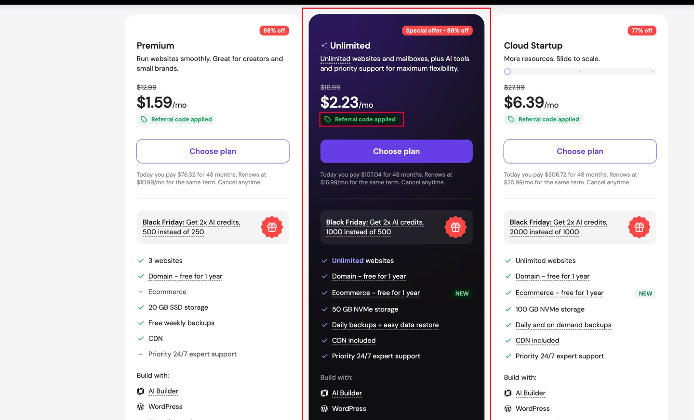
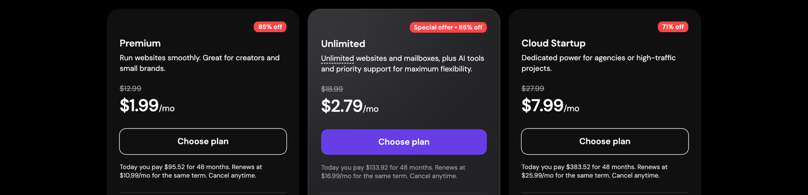
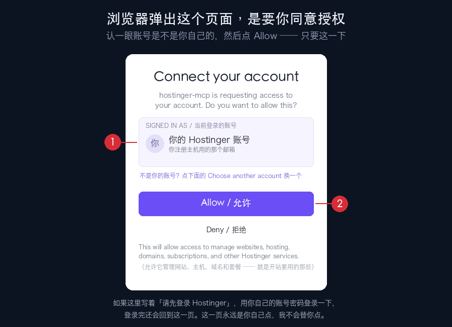
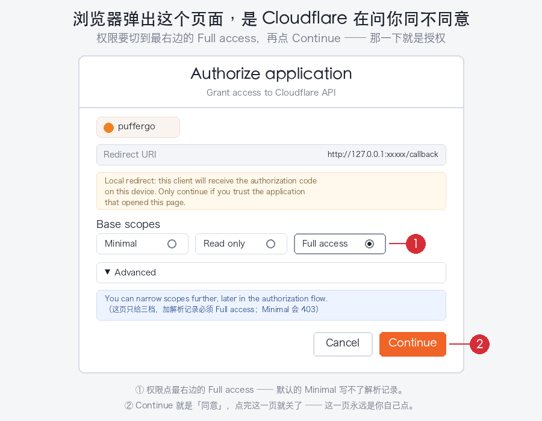
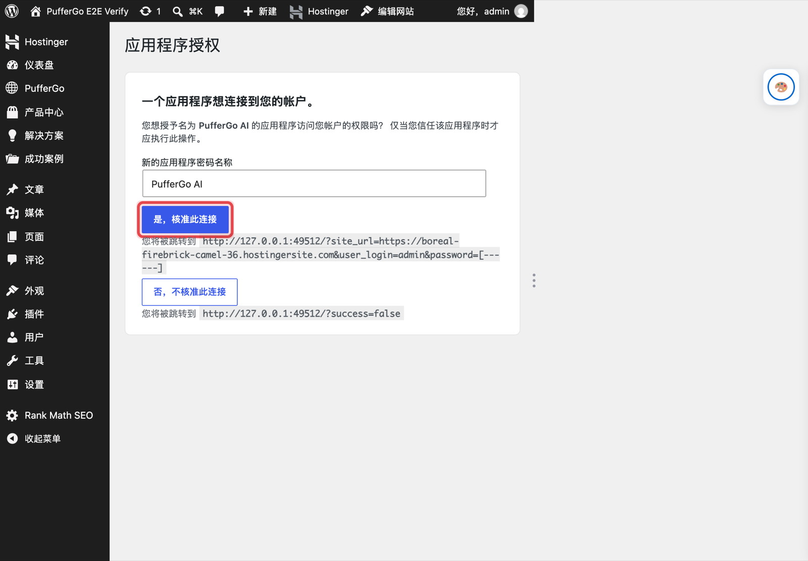

# 无技术背景的人如何通过 AI 工具轻松搭建独立站

> **不想自己动手？** 填 3 项，我们免费帮你把 WordPress 环境装好（域名解析、主机、证书、插件全包，前 100 位 0 元）：
> **https://puffergo.com/wp/free-wordpress-setup?from=ai**

## 你只做 6 件事

| 你做 | 什么时候 |
|---|---|
| 点一次「Allow」（首次连主机，浏览器弹的授权页） | 第 4 步，AI 用到主机时自动弹 |
| 切到 Full access + 点一次「Continue」（首次配解析，Cloudflare 弹的授权页） | 第 5 步，AI 用到 Cloudflare 时自动弹 |
| 说「可以」（确认域名 / 主机报价） | 第 2、3 步 |
| 买主机、结账页扫码付款（Country 选 Hong Kong） | 第 3 步 |
| 连一次 PufferGo（没账号顺手注册，两下点完） | 第 6 步 |
| 点一次「批准」 | 第 7 步 |

其余全是 AI 干：查域名、**开站装 WordPress**、配解析、装插件、写页面。装 WordPress 你不用动手——AI 装好后，主机商会把登录信息发到你邮箱，你第一次登录时自己改个密码就行。**你的密码不用告诉任何人，AI 也不知道。**

---

## 第 1 步：打开 AI 工具，发这句话

任何能装技能的 AI 工具用法都一样——装好 PufferGo 技能包后，发同一句话：

> 我想做一个外贸网站，帮我把域名和主机买好、WordPress 装好。我完全不懂技术，你别问我技术问题，一步一步带我。

**AI 不会主动找你，这句话就是开场。**

---

## 第 2 步：给它一个域名

> **AI**：你的域名是什么？有的话直接发我，我帮你接过来。
> **你**：还没想好，我做户外装备出口，帮我想几个
> **AI**：（给 5 个候选，每个带价格）
> **你**：要第二个
> **AI**：`yourbrand.com` 一年 11.17 美元，续费同价。要我继续吗？
> **你**：可以

**第一次买域名不用绑卡。** 在你的阿里云、腾讯云账号里买，或者在 Hostinger 买，支付宝扫码就行。买完把域名发给 AI，它帮你把解析接到 Cloudflare——这一步免费，不花一分钱。

要是你手上本来就有能用的卡或 PayPal，也可以直接在 Cloudflare 买，通常更便宜。这是可选项，不是必须。

买之前把域名逐字念一遍：注册后改不了，也退不了。

**价格会随汇率和活动变，AI 报的只是当天实价，付款前以官网结账页显示的金额为准。**

已经有域名（在阿里云、腾讯云买的）不用重新买，说一句「我的域名在阿里云，帮我转过来」。

---

## 第 3 步：买主机（这步你自己买）

**必须从这个链接进**，价格才便宜（优惠是链接带进去的，结账页没有让你填优惠码的地方，也不用自己搜 Hostinger 官网）：

```
https://www.hostinger.com/pricing?REFERRALCODE=puffergo
```

打开先看中间那张 **Unlimited**。**对的样子**是这样——2.23 美元/月，价格下面一行绿色 `Referral code applied`：

> 下图金额是 2026 年 11 月的实价，会随活动和汇率浮动，**以官网结账页为准**。认那行绿标，别死认数字——有 `Referral code applied` 就说明优惠生效了。



**如果显示 2.79 美元、也没有绿色那行，就是优惠没带上**，这样买贵 27 美元：



没带上就按这个顺序试，别自己猜：

1. 关掉页面，从上面那个链接重进一次
2. 还不对，换个浏览器（或开无痕窗口）再进
3. 仍然不对，多半是这个 Hostinger 账号以前买过——这个优惠只算新客户。换个账号，再用链接进

价格对了就往下做：

1. 点中间 **Unlimited** 的 **Choose plan**
2. **Period 保持 48 months**：一次付 107.04 美元用 4 年，平均 2.23 美元/月
3. 点 **Continue**，填邮箱、密码、地址（第一次买会顺便把 Hostinger 账号注册了）。**Country 选 Hong Kong**——香港没有增值税，价格就是最终价；选中国大陆会再加税
4. 付款方式选 **AliPay+**，扫码付

**机房（服务器放哪）选哪个？** 结账时它会问，按你客户主要在哪选：

| 客户主要在美国、加拿大 | 选美国 |
|---|---|
| 在英国、德国、法国、欧洲、中东 | 选荷兰 / 英国 / 德国 |
| 在东南亚（新马泰越、印尼） | 选新加坡 |
| 在印度、孟加拉 | 选印度 |
| 在巴西、南美 | 选巴西 |

没有你客户所在地的机房，就选最近的那个，剩下的交给 CDN——不用为这个纠结。

付完跟 AI 说「主机买好了」。

---

## 第 4 步：AI 帮你装 WordPress（登录信息放你桌面）

付完款跟 AI 说「主机买好了」，**开站和装 WordPress 都是 AI 自动做**，一两分钟的事。

**只会弹一次授权页，点一下就好。** 浏览器会跳出 Hostinger 的 **Connect your account**，上面写着「`hostinger-mcp` is requesting access to your account」，下面「SIGNED IN AS」是你自己的账号邮箱：



**先认一眼那个邮箱是不是你自己的**，是就点紫色按钮 **Allow**。这一步是你在允许 AI 用你的主机账号开站——所以**这一下永远是你自己点**，AI 不会替你点（它替你点了，你就不知道自己授权过什么了）。看到不是你的账号，点 **Choose another account** 换一个；还没登录 Hostinger 的话会先让你登录，登录完还会回到这一页。

装好后：

1. 看你的**桌面**，会多一个文件叫「`<你的域名>`-登录信息.txt」，双击就能打开
2. 里面写着后台地址、用户名和密码。用浏览器打开那个地址，填进去登入，**第一次登录把密码改成一个好记的**（改完把文件里那份也更新一下）
3. 跟 AI 说一声「装好了」，剩下的它来

看到网站打开是一条「Hello world」文章——**这不是没装好**，全新 WordPress 就长这样，内容还没写而已。

**关于密码：** 这个密码是 AI 建站时给你生成的，**同时写进了你桌面那个文件**，它在聊天里不会念出来、也不问你要。忘了密码就在登录页点「忘记密码」，重置信会发到你建站时填的管理员邮箱。

**AI 从来不要你的后台密码。** 它改网站靠的是你在后台点一次「批准」生成的专用钥匙（第 7 步），跟你的登录密码是两回事。

> **万一 AI 那边自动没成功**：它会把网页步骤发给你，让你在 hPanel 点几下自己装（Websites → Add Website → WordPress，密码你自己设，**设完也记到桌面那个文件里**）。这是备用路，正常用不到——只有 AI 明确说了才走。

---

## 第 5 步：等 AI 指域名

AI 自己在 Cloudflare 加记录，你只会听到一句「等几分钟到几小时生效」。

**第一次会弹一个 Cloudflare 的授权页**，标题是 **Authorize application**，写着 Grant access to Cloudflare API：



**先把权限切到最右边的 Full access，再点橙色的 Continue。** 别用默认的 Minimal——那一档只让看不让改，AI 加解析记录时会被 Cloudflare 拦回来（报 403）。这一页只给三档，要加记录就必须 Full access，绕不过去；AI 只用它加解析、开 SSL，你随时能在 Cloudflare 后台把这个授权撤掉。切权限和点 Continue 这两下都是你自己点——AI 不会替你授权你的 Cloudflare 账号。

页面里那条 `http://127.0.0.1:…/callback` 和「Local redirect」那段黄色提示是**正常的**，那是授权结果送回你自己电脑用的，不用担心。

**那条记录前面的云朵要是橙色的。** 橙色代表流量走 Cloudflare，国内打开更快、也更抗打；灰色代表直连海外服务器，国内访问会明显慢。AI 会自己设成橙色，你自己去后台看的时候**别把它点成灰色**。

**别自己去 Cloudflare 删记录。** 域名在收发邮件的话，删错一条邮件就收不到。要动先问 AI。

**站一能打开，你会先看到一套演示内容**：一个像样的首页、上面那条导航、3 个示例产品、2 篇示例案例、几篇示例文章。那是照着你的行业配的样板，用来看版式的，不是你的生意，AI 也不会拿它当你的内容去写。等你的产品、案例、页面做好了，说一声「把演示内容删掉」就行——后台 PufferGo → Dashboard →「Sample Data & Showroom」→「Delete Sample Data」，首页会一起还原。

---

## 第 6 步：连上 PufferGo 账号（点两下）

插件装好后，先进后台：**打开你桌面那个「`<你的域名>`-登录信息.txt」，用里面的后台地址和账号密码登录**。然后在左上角菜单点 **PufferGo**（或者在「仪表盘」页最上面那张卡片里点 **进入 PufferGo**）：


右边深色卡片点 **Connect now (30s)**：

1. 第一次会跳到 PufferGo 登录页。**没账号就点「立即注册」**：填邮箱 → 收一封 6 位验证码 → 设个密码，一分钟的事。以后登录也可以只用邮箱验证码，不用记密码
2. 登录完自动回到授权页，点一次 **授权并连接**

页面自己跳回后台，显示已连接就好了。**不用抄任何密钥、不用填任何东西**——密钥是它在后台直接写进去的。

这一步解锁的是插件里的 AI 功能（AI 建站、写内容、SEO）。下一步「批准」是另一件事，给 AI 改你网站的权限。两个都要点，各点一下按钮就完了。

---

## 第 7 步：点一次「批准」

AI 会发一个链接，打开长这样：



**点红框里那个蓝按钮。** 不用填任何东西，不用输密码。链接 10 分钟内有效，过期让它再发一个。

点完，AI 就能替你改页面、写文章、上产品了。**整个过程它从来不要你的后台密码。**

---

## 第 8 步：开始用

直接说要什么：

- 「帮我做一个关于我们的页面」
- 「首页大标题改成公司全称」
- 「上架这个产品，39 美元，用这三张图」

它做完给你链接，**你自己点开看一眼**。

日常怎么用、钥匙怎么管、不想用了怎么彻底关掉，看 **USER-GUIDE.md**。

---

## 卡住了，就说这一句

**把屏幕上的字原样复制给 AI。** 不要说「不行了」——它没法从这句话里看出问题，报错原文它能直接定位。

| 你说 | 它理解成 |
|---|---|
| 「报 403」 | 域名指到主机了，但主机上还没绑这个域名 |
| 「付款卡住了」 | 要你去银行 App 或 hPanel 确认 |
| 「临时地址能打开，我的域名打不开」 | 记录还没生效 |
| 「Connect 打开是白屏 / 打不开授权页」 | VPN 挡了，关掉 VPN 再点 |
| 「链接过期了」 | 重新发一个授权链接 |

---

## 三件事记住

1. **别把你自己的密码发在聊天里。** 你的邮箱密码、Hostinger 密码、后台密码、邮箱授权码，AI 一次都不需要。后台密码是 AI 生成后写进你桌面那个文件的，你自己收着就行；它改站靠的是你在后台点一次「批准」生成的专用钥匙，跟你的登录密码无关。
2. **付款前看清金额。** 域名和主机都是预付，首年便宜、续费按原价。
3. **域名要续费。** 到期不续会被释放，别人能买走，网站直接消失。
