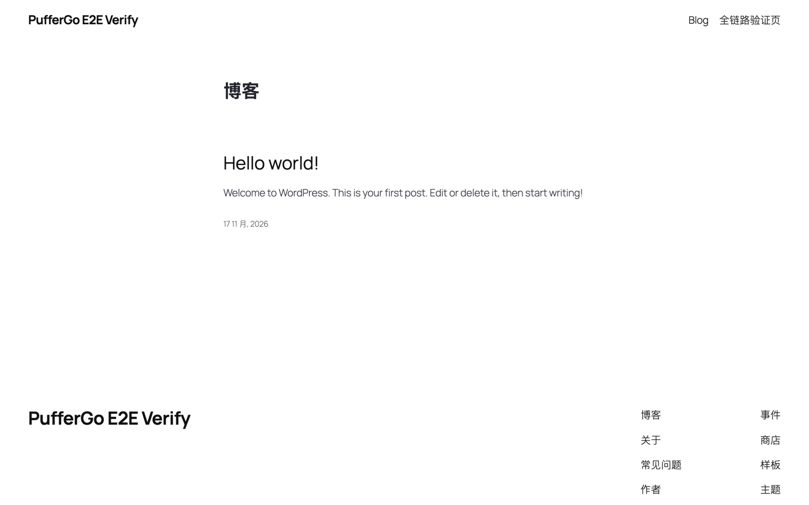
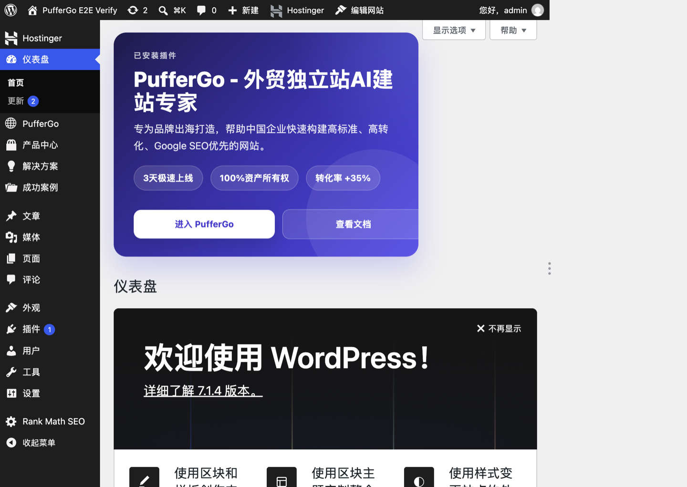

# 无技术背景的人如何通过 WorkBuddy、Codex、豆包、千问等 AI 工具轻松搭建独立站

> **不想自己动手？** 填 3 项，我们免费帮你把 WordPress 环境装好（域名解析、主机、证书、插件全包，前 100 位 0 元）：
> **https://puffergo.com/wp/free-wordpress-setup?from=ai**

## 你只做 5 件事

| 你做 | 什么时候 |
|---|---|
| 注册 Hostinger、Cloudflare 账号 | 第 2、3 步 |
| 说「买」（域名） | 第 2 步 |
| 买主机、扫码付款 | 第 3 步 |
| 连一次 PufferGo（没账号顺手注册，两下点完） | 第 6 步 |
| 点一次「批准」 | 第 7 步 |

其余全是 AI 干：查域名、买域名、装 WordPress、指域名、装插件。

---

## 第 1 步：打开 AI 工具，发这句话

下面以 WorkBuddy 为例，其他 AI 工具用法一样——装好 PufferGo 技能包后，发同一句话：

> 我想做一个外贸网站，帮我把域名和主机买好、WordPress 装好。我完全不懂技术，你别问我技术问题，一步一步带我。

**AI 不会主动找你，这句话就是开场。**

---

## 第 2 步：给它一个域名

> **AI**：域名想好了吗？
> **你**：没想好，我做户外装备出口，帮我想几个
> **AI**：（给 5 个候选，每个带价格）
> **你**：要第二个
> **AI**：`yourbrand.com` 一年 11.17 美元，续费同价。确认买吗？
> **你**：买

第一次买域名，Cloudflare 要你先绑一张卡、填联系人。**这一步只能你在网页上做**，AI 会把链接发你。绑一次就够，以后不用再绑。

买之前把域名逐字念一遍：注册后改不了，也退不了。

**价格会随汇率和活动变，AI 报的只是当天实价，付款前以官网结账页显示的金额为准。**

已经有域名（在阿里云、腾讯云买的）不用重新买，说一句「我的域名在阿里云，帮我转过来」。

---

## 第 3 步：买主机（这步你自己买）

**必须从这个链接进**，价格才便宜（优惠是链接带进去的，结账页没有让你填优惠码的地方，也不用自己搜 Hostinger 官网）：

```
https://www.hostinger.com/pricing?REFERRALCODE=puffergo
```

打开先看中间那张 **Unlimited**。**对的样子**是这样——2.23 美元/月，价格下面一行绿色 `Referral code applied`：

> 下图金额是 2026 年 11 月的实价，会随活动和汇率浮动，**以官网结账页为准**。认那行绿标，别死认数字——有 `Referral code applied` 就说明优惠生效了。


**如果显示 2.79 美元、也没有绿色那行，就是优惠没带上**，这样买贵 27 美元：


没带上就按这个顺序试，别自己猜：

1. 关掉页面，从上面那个链接重进一次
2. 还不对，换个浏览器（或开无痕窗口）再进
3. 仍然不对，多半是这个 Hostinger 账号以前买过——这个优惠只算新客户。换个账号，再用链接进

价格对了就往下做：

1. 点中间 **Unlimited** 的 **Choose plan**
2. **Period 保持 48 months**：一次付 107.04 美元用 4 年，平均 2.23 美元/月
3. 点 **Continue**，填邮箱、密码、地址（第一次买会顺便把 Hostinger 账号注册了）。**Country 选 Hong Kong**——香港没有增值税，价格就是最终价；选中国大陆会再加税
4. 付款方式选 **AliPay+**，扫码付

付完跟 AI 说「主机买好了」。

---

## 第 4 步：等 AI 装 WordPress

AI 说「在装，几分钟」，这期间你什么都不用做。

装好之后打开网址，是这样：



**这不是没装好。** 全新 WordPress 就长这样：一条示例文章、一套默认菜单，内容还没写。

---

## 第 5 步：等 AI 指域名

AI 自己在 Cloudflare 加记录，你只会听到一句「等几分钟到几小时生效」。

**别自己去 Cloudflare 删记录。** 域名在收发邮件的话，删错一条邮件就收不到。要动先问 AI。

---

## 第 6 步：连上 PufferGo 账号（点两下）

插件装好后，进后台：`你的域名.com/wp-admin`，左上角菜单点 **PufferGo**（或者在「仪表盘」页最上面那张卡片里点 **进入 PufferGo**）：



右边深色卡片点 **Connect now (30s)**：

1. 第一次会跳到 PufferGo 登录页。**没账号就点「立即注册」**：填邮箱 → 收一封 6 位验证码 → 设个密码，一分钟的事。以后登录也可以只用邮箱验证码，不用记密码
2. 登录完自动回到授权页，点一次 **授权并连接**

页面自己跳回后台，显示已连接就好了。**不用抄任何密钥、不用填任何东西**——密钥是它在后台直接写进去的。

这一步解锁的是插件里的 AI 功能（AI 建站、写内容、SEO）。下一步「批准」是另一件事，给 AI 改你网站的权限。两个都要点，各点一下按钮就完了。

---

## 第 7 步：点一次「批准」

AI 会发一个链接，打开长这样：


**点红框里那个蓝按钮。** 不用填任何东西，不用输密码。链接 10 分钟内有效，过期让它再发一个。

点完，AI 就能替你改页面、写文章、上产品了。**整个过程它从来不要你的后台密码。**

---

## 第 8 步：开始用

直接说要什么：

- 「帮我做一个关于我们的页面」
- 「首页大标题改成公司全称」
- 「上架这个产品，39 美元，用这三张图」

它做完给你链接，**你自己点开看一眼**。

日常怎么用、钥匙怎么管、不想用了怎么彻底关掉，看 **USER-GUIDE.md**。

---

## 卡住了，就说这一句

**把屏幕上的字原样复制给 AI。** 不要说「不行了」——它没法从这句话里看出问题，报错原文它能直接定位。

| 你说 | 它理解成 |
|---|---|
| 「报 403」 | 域名指到主机了，但主机上还没绑这个域名 |
| 「付款卡住了」 | 要你去银行 App 或 hPanel 确认 |
| 「临时地址能打开，我的域名打不开」 | 记录还没生效 |
| 「Connect 打开是白屏 / 打不开授权页」 | VPN 挡了，关掉 VPN 再点 |
| 「链接过期了」 | 重新发一个授权链接 |

---

## 三件事记住

1. **别在聊天里发密码。** 正常流程里 AI 一次都不需要。
2. **付款前看清金额。** 域名和主机都是预付，首年便宜、续费按原价。
3. **域名要续费。** 到期不续会被释放，别人能买走，网站直接消失。
