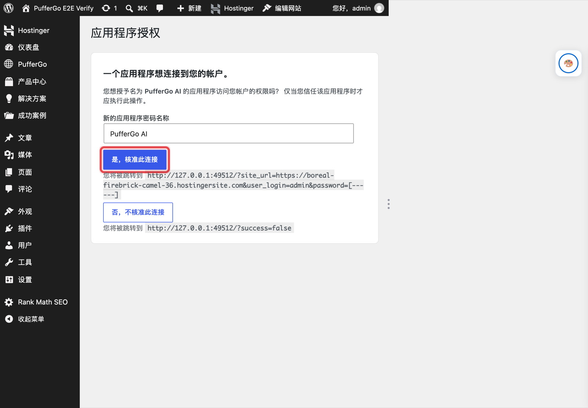
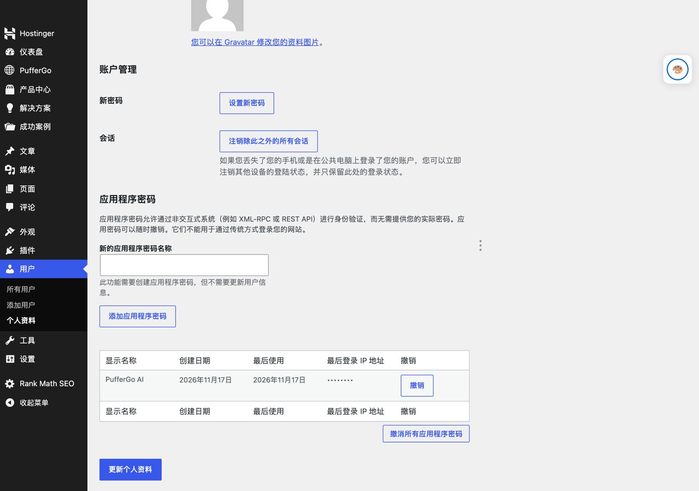

# 新手使用指南：让 AI 帮你改网站

这份文档给**已经有一个能打开的网站**的人看。网站还没建起来、连域名和主机都还没买的，先看同目录的 **GETTING-STARTED.md**（从零建站全过程），站建好了再回来。

这份文档只需要你会两件事：点一下按钮，说一句人话。不需要懂 WordPress、不需要懂代码、不需要记命令。

**用之前请确认**：你有一个已经能打开的 WordPress 网站，并且上面装了 PufferGo 插件（安装这一步由服务商或 AI 帮你做，你不用管）。你要准备的只有一样——**你网站的网址**，比如 `www.你的域名.com`。

---

## 你只需要做两件事

1. **点一次「核准」**（只有第一次要，以后不用）
2. **说出你想改什么**

剩下的都由 AI 完成。

---

## 第一步：点一下「核准」

当你第一次让 AI 帮你改网站时，浏览器会弹出一个页面，长这样：

你需要做的只有一件事：**点那个红框里的蓝色按钮「是，核准此连接」**。

几个让你放心的细节：

- 这个页面是**你自己的 WordPress 网站**弹出来的，不是第三方网站。看地址栏，开头是你自己的域名。
- 页面上写着「一个应用程序想连接到您的帐户」，应用名是 **PufferGo AI**。这就是你正在用的工具。
- 上面的框里会自动填好名字，**不用改**，也不用填任何密码。
- 这个页面**10 分钟内有效**。超时了没关系，让 AI 再发一次链接就行。
- 下面的「否，不核准此连接」**别点**。万一点错了也不会有损失，让 AI 重新发一次就行。

> 如果弹出页面前先出现了登录框，用你**平时登录网站后台的账号密码**登录即可。忘了就点「忘记密码？」。

**同样的道理，别的授权页也是你自己点。** 第一次让 AI 用你的主机账号时，浏览器会弹 Hostinger 的 **Connect your account**，认一眼账号邮箱，点 **Allow**；第一次配域名解析时，会弹 Cloudflare 的 **Authorize application**，先把权限切到最右边的 **Full access**（默认那档写不了解析），再点 **Continue**。这几下（含这里的「核准」）AI 都不会替你点——替了你，你就不知道自己授权过什么了。

---

## 第二步：直接说话

点完「核准」，就可以像跟同事说话一样提要求了。下面这些都能直接用：

| 你想做什么 | 你可以这样跟 AI 说 |
|---|---|
| 做个新页面 | 「帮我做一个『关于我们』页面，介绍公司成立时间和主营产品」 |
| 改已有页面 | 「把首页大标题改成『专注户外装备 15 年』」 |
| 加一块内容 | 「在首页加一个客户评价区块，放三条真实评价」 |
| 写文章 | 「写一篇关于户外帐篷怎么选的文章，发到博客」 |
| 上架产品 | 「把这个产品上架：折叠椅，价格 39 美元，用我发的这三张图」 |
| 改价格 | 「把折叠椅的价格改成 45 美元」 |

说完之后，AI 会告诉你它要做什么、做了什么。**做完让它给你看链接**，点开确认是不是你想要的样子，不满意就继续说。

---

## 那把「钥匙」是什么

AI 能替你干活，靠的是一把**专用钥匙**。它叫「应用程序密码」，长得像下面这样：

它藏在网站后台的 **用户 → 个人资料 → 应用程序密码**（把页面拉到最下面）。

有三件事你要知道：

1. **它不是你的登录密码。** 拿着它进不了网站后台。但它能以你的身份调用网站接口（改内容、发文章），所以同样不能外传。
2. **它随时可以作废。** 点右边那个「撤销」，立刻失效，AI 马上就不能动了。
3. **每台电脑各有一把。** 你换了新电脑，要重新核准一次。

---

## 不想再用了，怎么关掉

这里有个很多人会搞错的地方，**「断开」和「撤销」是两件事**：

| 你做的动作 | 效果 |
|---|---|
| 跟 AI 说「断开这个网站」 | 只删掉**这台电脑上**保存的钥匙，服务器上那把还在 |
| 到网站后台点「撤销」 | 那把钥匙**彻底作废**，谁都再用不了 |

所以：

- **只是想换台电脑用** → 让 AI 断开旧的，在新电脑上重新核准。
- **担心不安全，想彻底停掉** → 一定要去后台点「撤销」。只断开是不够的。

---

## 卡住了怎么办

| 遇到的情况 | 怎么办 |
|---|---|
| 浏览器没弹出授权页 | 让 AI 把链接**发给你**，你复制到浏览器打开 |
| 点了「否，不核准此连接」 | 没事，让 AI 再发一次，重新点「是，核准此连接」 |
| 提示「链接已过期」 | 超过 10 分钟了，让 AI 重新生成一个 |
| AI 说「没有权限」「登录失效」 | 钥匙可能被撤销了，重新走一次第一步 |
| 换了电脑，AI 说没登录 | 正常，每台电脑要单独核准一次 |
| 忘了 WordPress 后台密码 | 在登录页点「忘记密码？」，按邮件重置 |

---

## 最后三条提醒

1. **不要把你的密码发在聊天里。** 邮箱密码、主机密码、WordPress 后台密码、SMTP 授权码，AI 从来不需要，你也不用贴。后台密码是 AI 生成后写进你桌面那个「登录信息」文件的，你自己收着就行；它改站靠的是你在后台点一次「批准」生成的专用钥匙，跟你的登录密码无关。
2. **看到不确定的授权请求，先问。** 页面上如果应用名不是 PufferGo AI，别点核准。
3. **AI 说「做完了」之后，一定自己点开看一眼。** 命令执行成功不等于你要的效果达成了。
